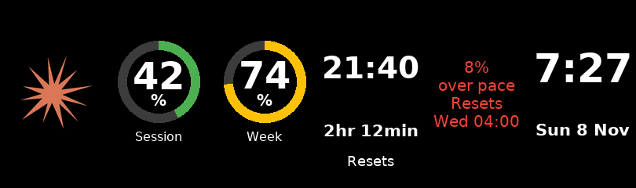

# HA Tubes

**Home Assistant on your six-tube clock.** HA Tubes is firmware for IPSTube and EleksTube-style IPS
clocks that turns each of the six little screens into a display Home Assistant can draw on, plus a
companion Home Assistant app, **Tube Display**, that designs, renders and rotates those screens for
you. It keeps everything the original clock firmware does and adds firmware updates over Wi-Fi.

HA Tubes is based on [EleksTubeIPS](https://github.com/judge2005/EleksTubeIPS) by Paul Andrews
(judge2005), used under the MIT licence. See [Credits](#credits).




*Screens rendered by the Tube Display app: a usage dashboard, the next train, and a big HH:MM clock.*

## What HA Tubes adds

### Panels: full-screen pictures from Home Assistant
* Each tube can show a 135×240 picture sent over the network (`POST /panel`), instead of a digit.
* Two display modes: **Panels** (all six tubes) and **Four + Panel** (a 4-digit clock plus one
  picture tube).
* Pictures stream straight to the screens and are never written to flash, so updating them every few
  seconds causes no wear.
* The clock reports over MQTT which tubes are waiting for a picture (`panels_needed`), so Home Assistant
  can resend after a restart or screen-saver.
* In Panels mode the clock's button asks Home Assistant for the next screen.
* A **Panels** page in the clock's web UI shows the live panel status.

### Tube Display, the Home Assistant app
* Renders screens from Home Assistant states with templates: rings, big numbers, text, icons
  (Material Design Icons), bars, sparklines, pictures and camera images.
* Rotates through screens with per-screen durations and refresh rates, or switches only when you press
  the clock's button (**Cycle automatically** off).
* A visual **screen editor** in the Home Assistant sidebar:
  * a live six-tube preview with real values
  * an entity picker and colour thresholds (green/amber/red)
  * icon autocomplete and a picture library with uploads
  * a YAML view for anything else
* Home Assistant entities to pick or pin a screen and to turn rotation on or off.

### Firmware updates over Wi-Fi
* A two-slot flash layout on the 8 MB IPSTube clocks. After one USB install, every later update goes
  over Wi-Fi.
* Three ways to update:
  * upload a `.bin` on the clock's **Info** page
  * `curl --data-binary @firmware.bin http://<clock>/update`
  * press **Install** on the clock's **Firmware** update entity in Home Assistant
* Optional MD5 check, progress on the tubes and in Home Assistant, automatic restart into the new
  firmware.

### A refreshed web UI
* A new HA Tubes theme in light and dark, a regrouped menu, and new **Panels** and **About** pages.

### Everything from the original firmware
* Time, date, weather forecast and slide show display modes, with NTP time sync and automatic time
  zone / DST handling.
* Clock faces and weather icon sets you can upload, select and switch with the buttons.
* LED backlight effects, a digital-rain screen saver, and on/off hours.
* MQTT with Home Assistant discovery for every setting, custom text, file uploads and motion/light
  sensors.
* Builds for EleksTube v1, Si Hai, NovelLife SE, PCBWay "Punkcyber" and IPSTube clocks. Wi-Fi updates
  need the 8 MB IPSTube boards.

## Install the firmware

1. **First install, over USB.** Open the [web installer](https://nict41.github.io/HA-Tubes/) in Chrome
   or Edge on a computer, pick your clock and choose **Full install**.
   * IPSTube: hold the clock's power button while plugging in the USB cable.
   * Back up the original firmware first if you might want it back (see
     [Installation](https://github.com/judge2005/EleksTubeIPS/wiki/Installation) in the original
     project's wiki).

   Clocks already running EleksTubeIPS keep their settings and Wi-Fi details. Uploaded faces and
   icons go back to the built-in ones, because the file system moves to make room for the second
   firmware slot.
2. **Connect to Wi-Fi.** On first start the clock opens its own access point for you to enter your
   Wi-Fi details. See [Connecting to Wi-Fi](docs/user-guide.md#connecting-to-wi-fi).
3. **Later updates** go over Wi-Fi: the Info page, curl, or the Home Assistant Firmware entity. See
   [Updating over Wi-Fi](docs/user-guide.md#updating-over-wi-fi).

Release files for flashing by hand are on the [Releases](https://github.com/nict41/HA-Tubes/releases)
page. For an IPSTube they go at these addresses:

| Address | File |
|---|---|
| 0x1000 | bootloader |
| 0x8000 | partitions |
| 0xE000 | boot_app0 |
| 0x10000 | firmware |
| 0x410000 | file system |

## Connect it to Home Assistant

1. On the clock's **MQTT** page, enter your broker (for example the Mosquitto broker app). The clock
   appears in Home Assistant through MQTT discovery as one device:
   * settings as selects, numbers and switches
   * a **Firmware** update entity
   * custom text
   * panel status
2. Install the **Tube Display** app:
   1. In Home Assistant go to **Settings → Apps → App store**. Open the ⋮ menu, choose
      **Repositories** and add `https://github.com/nict41/nict41-s-HA-Apps`.
   2. Find **Tube Display**, install it, and on its **Configuration** tab set:
      * `clock_host`: the clock's IP address
      * `clock_mqtt_id`: shown on the clock's MQTT page, e.g. `209374ipstube`
      * `clock_user` / `clock_password`, if the clock's web UI has a login
   3. Start it, and turn on **Show in sidebar**.
3. Open **Tube Display** from the sidebar to build screens:
   1. Add a screen and tap a tube.
   2. Choose what it shows (an entity, fixed text or a template), its colour or colour thresholds, an
      icon or a picture.
   3. Save. The rotation runs straight away.

### How it fits together

```
Home Assistant states ──► Tube Display app ──renders 6 × 135×240 pictures──► POST /panel ──► clock
        ▲                    │  screens in /homeassistant/tube_display/screens.yaml
        │                    └─ MQTT: switches the clock to Panels, reads panels_needed,
        └──────── MQTT ◄────────── hears clock/<id>/button = next (the clock's button)
```

* The app renders each screen with Pillow from Home Assistant templates and sends one picture per
  tube.
* It re-renders on each screen's refresh interval and resends only when needed.
* `screens.yaml` is plain YAML. The editor writes it, and you can also edit it by hand: changes are
  picked up without a restart.

Full app documentation: the app's **Documentation** tab, or
[DOCS.md](https://github.com/nict41/nict41-s-HA-Apps/blob/main/tube_display/DOCS.md).

## Documentation

* [User Guide](docs/user-guide.md): every web UI page and setting, MQTT and Home Assistant, panels,
  Wi-Fi updates, the buttons.
* [Building](#building): compiling the firmware yourself.
* The original project's [wiki](https://github.com/judge2005/EleksTubeIPS/wiki) still applies to
  everything HA Tubes inherited: hardware, image collections, the hardware dimming mod.

## Building

The firmware is a [PlatformIO](https://platformio.org/) project. `pio run -e ipstube` builds the IPSTube
firmware. `pio run -e ipstube -t buildfs` builds its file system image, including the web UI from
`web/` (needs Node.js). Every pull request is built for all clocks in CI, and any compiler warning
fails the build.

## Credits

* **[EleksTubeIPS](https://github.com/judge2005/EleksTubeIPS)** by Paul Andrews (judge2005). HA Tubes
  started as a fork of it and keeps its clock, weather, LED, screen-saver, file and MQTT features.
  Thank you! Its MIT licence and copyright notice are kept in [LICENSE](LICENSE).
* [Original documentation and software from EleksMaker](https://wiki.eleksmaker.com/doku.php?id=ips).
* The people in
  [this reddit discussion](https://www.reddit.com/r/arduino/comments/mq5td9/hacking_the_elekstube_ips_clock_anyone_tried_it/),
  whose work the original firmware built on.
* Icons from [Material Design Icons](https://pictogrammers.com/library/mdi/).

HA Tubes is not affiliated with EleksMaker, IPSTube or the original project. Please report problems
with HA Tubes [here](https://github.com/nict41/HA-Tubes/issues), not upstream.
