# User Guide

How to set up and use a clock running [HA Tubes](https://github.com/nict41/HA-Tubes), which is based on [EleksTubeIPS](https://github.com/judge2005/EleksTubeIPS). To install it, use the [web installer](https://nict41.github.io/HA-Tubes/) (see the [README](../README.md#install-the-firmware)); the original project's [Installation](https://github.com/judge2005/EleksTubeIPS/wiki/Installation) page covers backing up the clock's original firmware.

* [Connecting to Wi-Fi](#connecting-to-wi-fi)
* [Status messages](#status-messages)
* [The web UI](#the-web-ui): [Clock](#clock), [Panels](#panels-page), [LEDs](#leds), [Files](#files), [Weather](#weather), [Screen Saver](#screen-saver), [MQTT](#mqtt-and-home-assistant), [Network](#network), [Info](#info), [About](#about)
* [Clock buttons](#clock-buttons)
* [Showing your own text](#showing-your-own-text)
* [Showing pictures from Home Assistant (panels)](#showing-pictures-from-home-assistant-panels)
* [Uploading files over MQTT](#uploading-files-over-mqtt)
* [Updating over Wi-Fi](#updating-over-wi-fi)

## Connecting to Wi-Fi

After installing, the web installer may offer to connect the clock to your Wi-Fi network. Otherwise, if the clock can't join a network when it starts, it opens its own access point:

1. The bottom of the displays takes turns showing the access point's **WiFi network** name, such as `HATubesB2C3`, and its **WiFi password**. If the clock tried to join a network and couldn't, it also shows why, as a **WiFi problem**.
2. Join that network from your phone or computer, using that password. A page from the clock should open by itself. If it doesn't, go to http://192.168.4.1.
3. Choose **Configure WiFi**, choose your network from the list and enter its password. **Scan** refreshes the list. You can change the clock's hostname here too, which you'll need to if you have more than one clock. Then choose **save**.
4. The clock joins your network and shows its IP address for a few seconds. The access point closes 30 seconds later. If the clock can't join, the displays and the **Info** page say why: **Wrong password?**, **Network not found** or **Can't connect**. The access point stays on so you can try again.

The page has other buttons too:

* **Configure Static WiFi** is the same as Configure WiFi, but also gives the clock a fixed IP address. An empty Subnet means 255.255.255.0, and an empty DNS1 means the gateway.
* **Set Clock Time** sets the clock to your phone's or computer's time, for a clock with no internet connection.
* **Configure Clock** opens the [web UI](#the-web-ui) over the access point.
* **Info** says whether the clock has joined a network, or why it can't, and shows details of the clock. **Reset** restarts it.

Each clock makes up its own access point password the first time it starts. The [Network](#network) page shows it and can change it. To move the clock to a different network later, turn on **WiFi AP** on the Network page and follow the steps above.

If the clock loses its network while it's running, it keeps trying to rejoin, but doesn't open its access point by itself. So if it can't get back on, for example because your router's password changed, unplug it and plug it back in. It opens the access point when it finds it can't join.

## Status messages

Messages appear for a few seconds at the bottom of the displays, mostly while the clock starts:

| Message | Meaning |
|---|---|
| setup... | The clock is starting. |
| Connecting... | It's joining your Wi-Fi network. |
| WiFi network and WiFi password | The access point is on, see [Connecting to Wi-Fi](#connecting-to-wi-fi). |
| WiFi problem | The access point is on, and this is why the clock can't join a network: Wrong password?, Network not found or Can't connect. |
| An IP address, such as 192.168.1.50 | It has joined your Wi-Fi network at that address. |
| AP Destroyed... | The access point has closed. |
| NTP time received... | It has set its time from the time server. |
| Not enough space! | There isn't room for the clock face, weather icons or slide show it was changing to, so it kept the one it had. See [Files](#files). |
| Not enough memory! | The clock was too busy serving web pages to load the clock face, weather icons or slide show it was changing to, so it kept the one it had. Wait a minute and try again. |
| Couldn't unpack! | The clock face, weather icons or slide show it was changing to couldn't be loaded, so it's showing the one before. The [Files](#files) page says why. |

## The web UI

Go to http://elekstubeips.local, or your clock's hostname followed by `.local`. If that doesn't work on your phone or computer, use the IP address the clock shows when it joins your Wi-Fi network. To see it again, unplug the clock and plug it back in. If the web UI has a login, set on the [Network](#network) page, your browser asks for it.

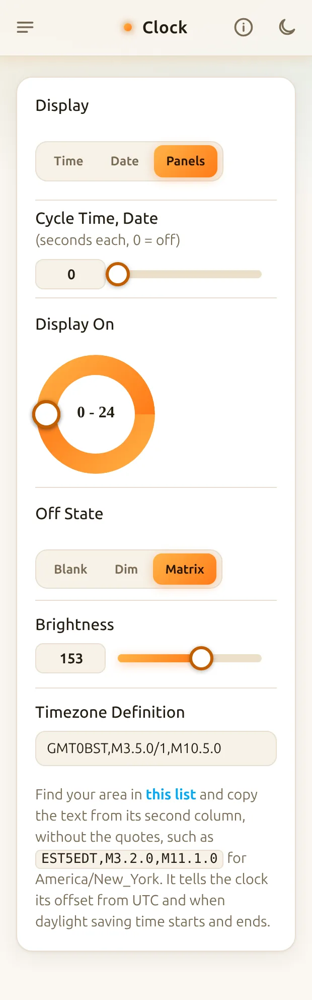 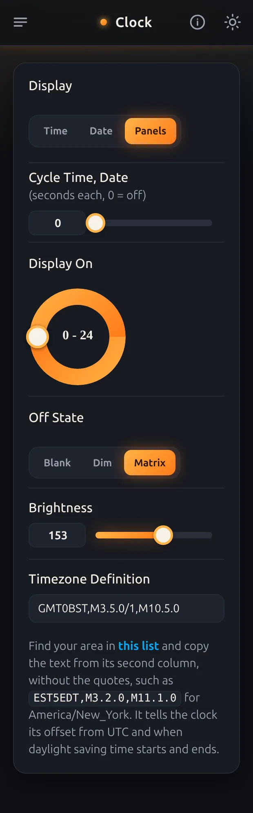

At the top of every page:

* The menu button, on the left, goes to the other pages.
* The **i** button opens the part of this guide for that page.
* The moon or sun button switches between the light and dark themes. Until you use it, the web UI follows your phone's or computer's light or dark setting. After that, the browser remembers your choice.

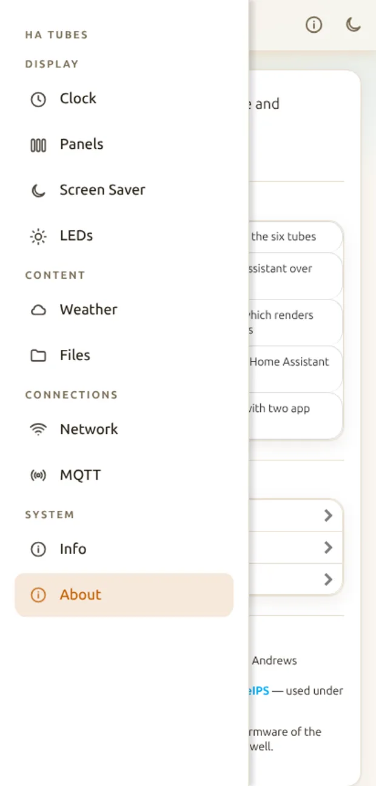

The menu groups the pages: **Display** ([Clock](#clock), [Panels](#panels-page), [Screen Saver](#screen-saver), [LEDs](#leds)), **Content** ([Weather](#weather), [Files](#files)), **Connections** ([Network](#network), [MQTT](#mqtt-and-home-assistant)) and **System** ([Info](#info), [About](#about)).

There's no Save button. A change takes effect on the clock straight away, and the clock saves it within a minute, so it's kept when the clock restarts. Changes made with the clock's buttons or from Home Assistant appear in the web UI as they happen.

## Clock


* **Display** chooses what the clock shows: the **Time**, the **Date**, the **Weather** forecast, a **Slide Show** of pictures or **Panels**, pictures streamed to the displays over HTTP, see [Showing pictures from Home Assistant (panels)](#showing-pictures-from-home-assistant-panels). The clock's mode button cycles through the first four. While Panels is showing, the button asks Home Assistant's Tube Display app for its next screen instead, see [Clock buttons](#clock-buttons).
* **Cycle Time, Date, Weather** shows each of the time, the date and the weather for this many seconds, then moves on to the next. 0 turns it off. The weather is skipped if there's no OpenWeatherMap API key. A slide show isn't part of the cycle, and gives way to the time.
* **Number of Digits**, **12/24 Hour** and **Leading Zero** are shown when Display is Time:
  * **Six** shows hours, minutes and seconds.
  * **Four AM/PM** shows hours and minutes, a flashing colon, and AM or PM on the last display in 12-hour time.
  * **Four + Weather** shows today's forecast on the last display instead.
  * **Four + Picture** shows a picture from the slide show on the last display instead, changing every 10 seconds.
  * **Four + Panel** shows a picture streamed over HTTP on the last display instead, see [Showing pictures from Home Assistant (panels)](#showing-pictures-from-home-assistant-panels).
  * **Leading Zero** shows a 0 before single-digit hours, such as 09:30 rather than 9:30.
* **Date Format** is shown when Display is Date: DD-MM-YY, MM-DD-YY or YY-MM-DD.
* **Display On** sets the hours the displays are on. Drag the two handles. In "7 - 23", the displays come on at 7:00 and go off at 23:00. If the two numbers are the same, the displays are always on.
* **Off State** chooses what the displays do outside those hours: **Blank** turns them off, **Dim** carries on showing the same things more dimly, still cycling through the time, date and weather if Cycle Time, Date, Weather is set, and **Matrix** shows the digital rain animation, in the colors set on the [Screen Saver](#screen-saver) page.
* **Brightness** sets how bright the displays are, from 10 to 255.
* **Timezone Definition** tells the clock its offset from UTC and when daylight saving time starts and ends. Find your area in [this list](https://github.com/nayarsystems/posix_tz_db/blob/master/zones.csv) and copy the text from its second column, without the quotes, such as `EST5EDT,M3.2.0,M11.1.0` for America/New_York.

## Panels page

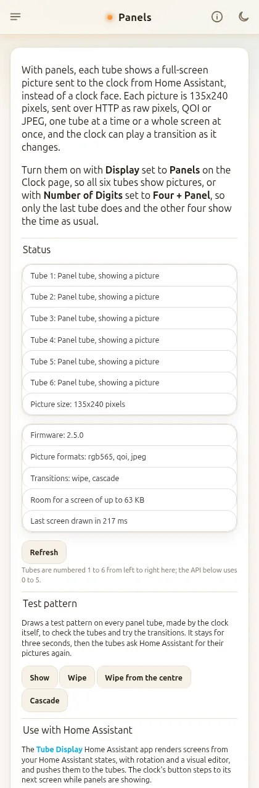

Explains panels and shows their live status: which tubes are panel tubes, and which are still waiting for a picture (after a restart, the screen saver or a status message, until Home Assistant sends it again). Below that: the firmware version, the picture formats and transitions it takes, how big a screen it can hold right now (less while GIFs play) and how long the last screen took to draw. **Refresh** checks again.

**Test pattern** draws a pattern on every panel tube, made by the clock itself, so you can check the tubes and try the transitions without Home Assistant: **Show** (straight away), **Wipe**, **Wipe from the centre** or **Cascade**. Each tube's pattern is different, with blocks at the bottom counting its number, and every press swaps between two looks so the transition shows. It stays for three seconds, then the tubes ask Home Assistant for their pictures again. Panels are turned on with **Display** set to **Panels**, or **Number of Digits** set to **Four + Panel**, on the [Clock](#clock) page. See [Showing pictures from Home Assistant (panels)](#showing-pictures-from-home-assistant-panels) for sending pictures.

## LEDs

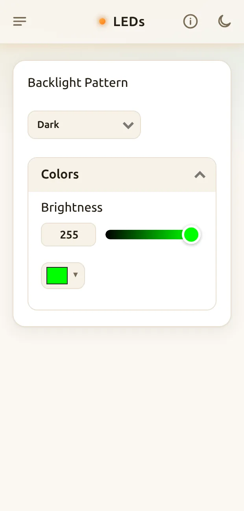

The LEDs light the displays from below.

* **Backlight Pattern**:
  * **Dark** turns them off.
  * **Constant** is one steady color.
  * **Rainbow** moves every color across the LEDs.
  * **Pulse** and **Breath** fade one color up and down, Breath more smoothly.
  * **Aurora** is like Rainbow, with a choice of how different neighboring LEDs' colors are.
* **Speed**, from 1 to 20, is for every pattern except Dark and Constant.
* **Colors Per Led**, from 1 to 10, is for Aurora. Higher numbers make neighboring LEDs' colors more different.
* **Hue**, **Saturation** and **Brightness** set the color, or use the color picker below them. Rainbow and Aurora use every hue, so they don't show Hue.

## Files

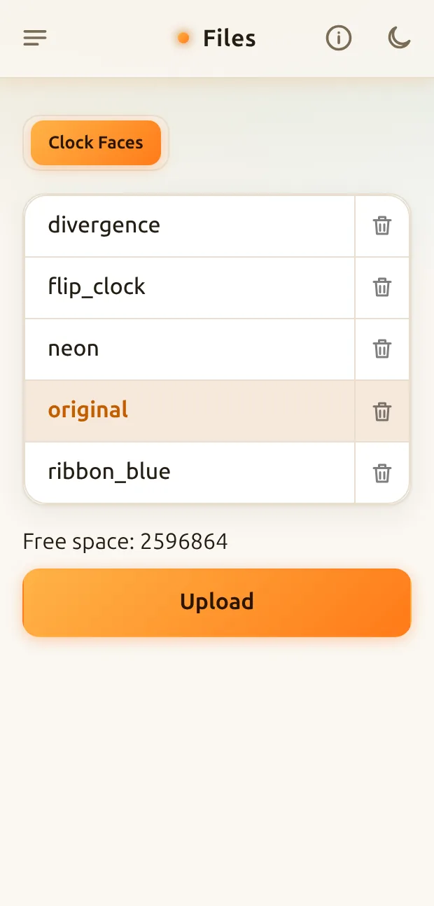

The clock's images come in sets, each in a `.tar.gz` file: clock faces, weather icons and slide shows.

* Choose **Clock Faces**, **Weather Icons** or **Slide Show** at the top to list them. The one in use is highlighted.
* Tap a name to use it. Changing takes a few seconds while the clock unpacks the images, and the displays show its progress.
* **Upload** adds a set from your phone or computer. One with the same name as a set already on the clock replaces it.
* The trash button deletes a set. You can't delete the one in use.
* **Free space** shows how much room is left for more.

The set in use in each list is also kept unpacked, which takes more room than its file. For example, the maxclassic weather icons take about 450 KB unpacked, and monochrome about 8 KB. If there isn't room for the set you tap, the clock keeps the one it had, and the Files page says so. Delete sets you don't use, or switch to smaller weather icons or the blank slide show, then try again. If it says the clock was too busy, it was short of memory while serving web pages, so wait a minute and try again.

You can also choose sets with the [clock's buttons](#clock-buttons), and upload and delete them over MQTT, see [Uploading files over MQTT](#uploading-files-over-mqtt).

More clock faces are in [more_faces](../more_faces) and at [Spider19996/Tube-Clock-Faces](https://github.com/Spider19996/Tube-Clock-Faces), and more weather icons in [weather_icons](../weather_icons). The clock comes with two slide shows, anime_female and blank. blank is there to free up space if you don't show pictures. To make your own sets, see [Image Collections](https://github.com/judge2005/EleksTubeIPS/wiki/Image-Collections) in the upstream wiki.

## Weather

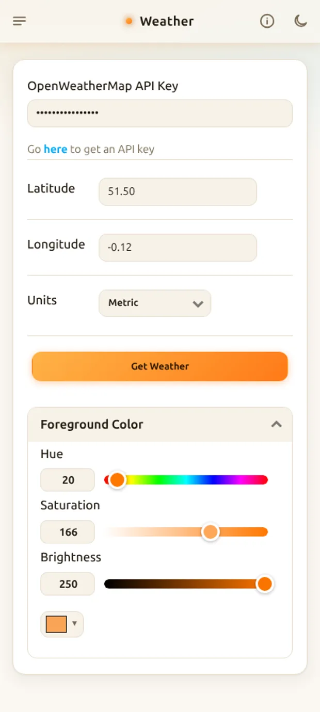

The forecast comes from [OpenWeatherMap](https://openweathermap.org/), and a free account is enough. The clock fetches it every 15 minutes.

The **IPSTube, Home Assistant only** build (`firmware-ipstube_ha-*.bin`) has no weather: Home Assistant shows it instead, and leaving it out saves the clock the memory it needs. That build has no Weather page, no Weather display or Four + Weather choice on the [Clock](#clock) page, no weather icons on the Clock Faces page and no weather entities in Home Assistant. A display or number of digits that showed the weather falls back to Time or Six.

* **OpenWeatherMap API Key**: create an account and an API key, and paste it here. Once it's set, the web UI shows dots instead of the key. To change it, type the new one over them.
* **Latitude** and **Longitude** are where the forecast is for, in degrees, such as 40.7128 and -74.0060 for New York. Map apps show them, for example when you right-click a place in Google Maps.
* **Units**: **Imperial** for °F, or **Metric** for °C.
* **Get Weather** fetches the forecast now. The displays take a few seconds to redraw.
* **Foreground Color** is the color of monochrome weather icons, such as the monochrome set, so you can match them to your clock face. Colored icon sets ignore it.


## Screen Saver

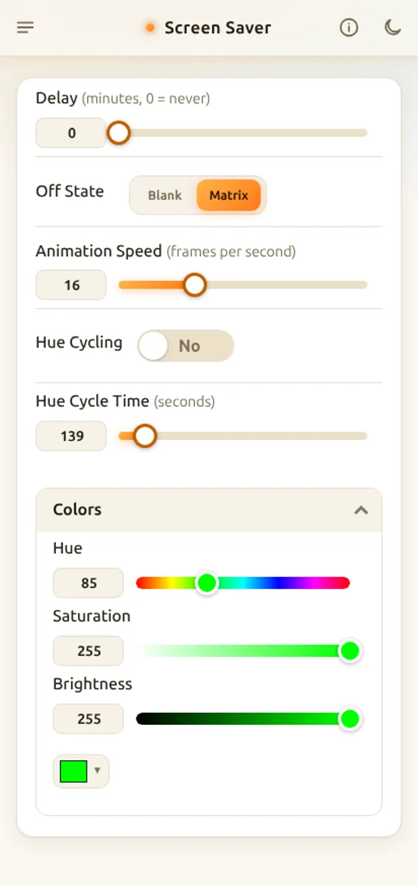

The screen saver starts when nobody has used the clock for a while. Any button on the clock, or any change in the web UI, stops it. To start it straight away, press the clock's power button.

* **Delay** is how many minutes it waits, from 1 to 120. 0 turns the screen saver off.
* **Off State** chooses the screen saver: **Blank** turns the displays off, but not the LEDs, and **Matrix** shows a digital rain animation like the one in The Matrix.
* **Animation Speed**, **Hue Cycling**, **Hue Cycle Time** and **Colors** set up the Matrix animation, here and when the Clock page's Off State is Matrix. Hue Cycling moves the animation's color through every hue, taking Hue Cycle Time seconds for each round.


## MQTT and Home Assistant

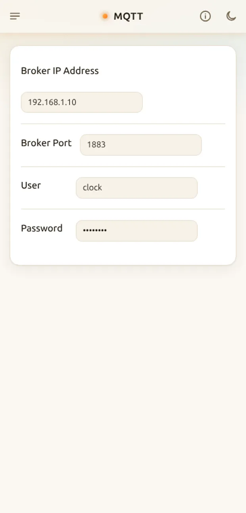

Connect the clock to an MQTT broker, such as Home Assistant's Mosquitto add-on, to control it from Home Assistant or your own scripts.

* **Broker IP Address** and **Broker Port**: the broker's address, and its port, usually 1883.
* **User** and **Password**: the broker's login, if it has one. Once the password is set, the web UI shows dots instead of it. To change it, type the new one over them.

If Home Assistant's MQTT integration uses the same broker, the clock appears in Home Assistant by itself, with almost every setting in the web UI. Everyday ones are listed under Controls, and set-and-forget ones under Configuration.

 

Topics start with `clock/<id>`, where `<id>` is the clock's **MQTT ID** from the [Info](#info) page, such as `A1B2C3elekstubeips`. It doesn't change when you change the hostname.

| Topic | Payload |
|---|---|
| `clock/<id>/set/brightness` | 10 to 255 |
| `clock/<id>/set/display` | 0 for the time, 1 the date, 2 the weather, 3 the slide show, 4 panels |
| `clock/<id>/set/screen_saver` | `ON` or `OFF` |
| `clock/<id>/set/custom` | Up to six characters to show instead of the time, see [Showing your own text](#showing-your-own-text) |
| `clock/<id>/set/backlight_state` | `ON` or `OFF` |
| `clock/<id>/set/backlight_hs` | Hue from 0 to 360 and saturation from 0 to 100, such as `240,100` |
| `clock/<id>/set/backlight_brightness` | 0 to 255 |
| `clock/<id>/set/restart` | Anything. Restarts the clock. Don't set the retain flag. |
| `clock/<id>/set/ota_install` | `install`: download and install the firmware named on `clock/<id>/ota/latest`, see [Updating over Wi-Fi](#updating-over-wi-fi). Don't set the retain flag. |

IPSTube clocks have the same three topics for the underlight, such as `clock/<id>/set/underlight_hs`, though it's turned on and off together with the backlight. Every other setting has a topic too, which Home Assistant shows under the entity's **MQTT INFO**.

The clock publishes its state on `clock/<id>/volatile/state` (brightness, display, screen saver, backlight, custom text and the panel tubes, `panel_tubes` and `panels_needed`, see [Showing pictures from Home Assistant (panels)](#showing-pictures-from-home-assistant-panels)) and `clock/<id>/persistent/state` (the settings, without passwords or the API key), and `online` or `offline` on `clock/<id>/availability`.

It also publishes:

* `clock/<id>/ota/state` (retained): the installed and latest firmware versions and update progress, for Home Assistant's **Firmware** update entity, see [Updating over Wi-Fi](#updating-over-wi-fi).
* `clock/<id>/button` = `next` (not retained) when the button is pressed while panels are showing. The Tube Display app listens for it to show its next screen; your own automations can too.

Besides the settings, Home Assistant gets a **Firmware** update entity (under Configuration) and a **Restart** button. The two pictures above are from the original firmware, so they don't show the Firmware entity or the Panels options.

For example, an automation can follow the sun with the clock's brightness: full brightness in daylight, fading to the lowest as the sun goes down:

```yaml
- alias: Clock brightness follows the sun
  mode: restart
  triggers:
    - trigger: state
      entity_id: sun.sun
      attribute: elevation
  actions:
    - variables:
        elevation: "{{ state_attr('sun.sun', 'elevation') | float(0) }}"
        # 0 at 6° below the horizon (dusk) or lower, 1 at 3° above or higher
        daylight: "{{ [0, [1, (elevation + 6) / 9] | min] | max }}"
    - action: number.set_value
      target:
        entity_id: number.ips_clock_brightness
      data:
        value: "{{ (10 + 245 * daylight) | round(0) | int }}"
```

## Network

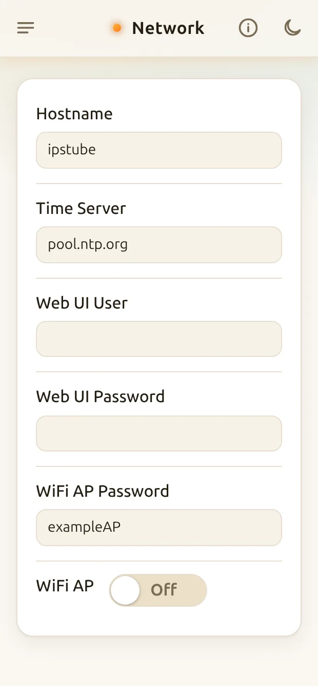

* **Hostname** is the clock's name on your network, so the web UI is at http://*hostname*.local. Give each clock its own. It can have letters, digits and hyphens, without a hyphen at either end. The clock restarts when you change it.
* **Time Server** is where the clock gets the time, by name or IP address, such as a server on your own network. The default is pool.ntp.org.
* **Web UI User** and **Web UI Password** set a login for the web UI. Set both and the clock asks for them before every page, upload and `/custom` request. Clear either one to turn the login off. The user can have letters, digits and `. _ - @`, and the password letters, digits, spaces and punctuation, without accents. Setting or changing the login disconnects any web UI that's open, so reload it and log in. If you forget the login, start the clock where it can't join your Wi-Fi, connect to its access point, choose **Configure Clock** and change it here, since the clock doesn't ask for it over its access point.
* **WiFi AP Password** is the access point's password. Type your own, at least 8 characters, or clear it for a new random one. A new password is used the next time the access point starts.
* **WiFi AP** turns the access point on or off, for example to move the clock to a different network, see [Connecting to Wi-Fi](#connecting-to-wi-fi). If the clock is on your network, the access point closes by itself once nobody has been on it for 10 minutes.

## Info

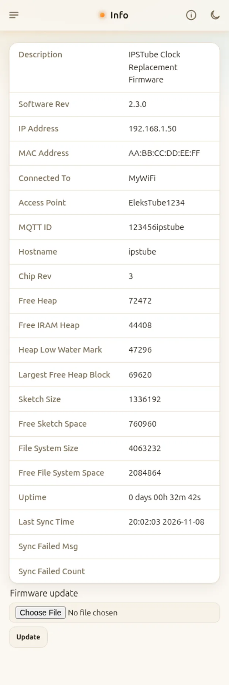

Details of the clock, mostly for troubleshooting:

* **Software Rev** is the firmware version.
* **IP Address**, **MAC Address** and **Connected To**, the Wi-Fi network the clock is on.
* **Access Point** is the name of the clock's access point.
* **MQTT ID** is what the clock's MQTT topics and Home Assistant entities are named after.
* The **Heap** rows show how much memory is free, and the **Sketch** and **File System** rows how much flash.
* **Uptime** is how long since the clock last started.
* **Last Sync Time** is when the clock last got the time from the time server, and **Sync Failed Msg** and **Sync Failed Count** say why and how often that failed.
* **Firmware update**, at the bottom: pick a `firmware-*.bin` file and press **Update** to install it over Wi-Fi, or a `littlefs*.bin` file to update the file system image. See [Updating over Wi-Fi](#updating-over-wi-fi).

## About

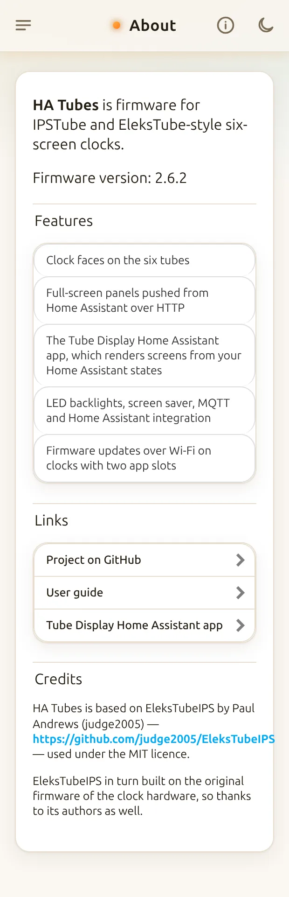

The firmware version, what HA Tubes does, links to the project, this guide and the Tube Display app, and the credits: HA Tubes is based on [EleksTubeIPS](https://github.com/judge2005/EleksTubeIPS) by Paul Andrews.

## Clock buttons

EleksTube and PCBWay PunkCyber clocks have four buttons: left, right, mode and power. The Si Hai has the same four, and the IPSTube has just power. The firmware doesn't use the NovelLife SE's buttons.

When the screen saver is running, pressing any button stops it, and does nothing else.

When the displays are on:

* Press power to start the screen saver.
* Hold power to turn the displays off, until you hold it again or until the next time Display On turns them on.
* Press mode to switch between the time, the date, the weather and the slide show.
* Hold mode for a menu of clock faces, or of weather icons or slide shows when they're showing. Press left and right to move up and down the list, press mode to choose, or hold mode to close the menu without changing anything.


When the displays are off for the night (outside the Display On hours):

* Press any button to show the displays for 10 seconds.
* Hold power to turn the displays back on, until you hold it again or until the next time Display On turns them off.

On the IPSTube, pressing power switches between the time, the date, the weather and the slide show, and holding it works as above.

**While panels are showing** (Display set to Panels), pressing the button (mode, or power on the IPSTube) doesn't change the display mode. Instead the clock publishes `next` on `clock/<id>/button`, and the [Tube Display](https://github.com/nict41/nict41-s-HA-Apps/tree/main/tube_display) app shows its next screen:

* With the app's **Cycle automatically** on, the press skips to the next screen and the rotation carries on from there.
* With it off, screens only change when you press the button, and the clock's own time display (the `clock` rotation entry) is skipped, since the button can't bring the panels back from it. To go back to the time, set the app's **Tube Display Screen** select in Home Assistant to **Clock**.

If the clock isn't connected to MQTT, the button falls back to switching display modes as usual.

## Showing your own text

The clock can show up to six characters instead of the time, one on each display, drawn with the clock face's images: digits, `:`, `a` for AM, `p` for PM, and a space or `_` for a blank display. Anything else shows as a blank. Send `clear`, or nothing, to go back to the time.

Over HTTP, for example with curl:

```
curl -d value=12:34 http://<clock>/custom
curl -d value=clear http://<clock>/custom
```

`curl http://<clock>/custom` replies with the text being shown. If the web UI has a login, add it with `-u <user>:<password>`. Over MQTT, publish the text to `clock/<id>/set/custom`, see [MQTT and Home Assistant](#mqtt-and-home-assistant).

## Showing pictures from Home Assistant (panels)

With **Display** set to **Panels**, all six displays show pictures streamed to the clock over HTTP instead of the time. With **Number of Digits** set to **Four + Panel** while Display is Time, only the last display does, and the other four show the time as usual. The clock's mode button skips Panels, so choose it in the web UI or over MQTT (`clock/<id>/set/display` with 4).

The easy way to use panels is the **[Tube Display](https://github.com/nict41/nict41-s-HA-Apps/tree/main/tube_display)** Home Assistant app. It switches the clock to Panels for you and draws screens from your Home Assistant states: rings, big numbers, text, icons, pictures and camera images. It rotates through them, or steps through them with the clock's button, and has a visual editor in the Home Assistant sidebar. See the [README](../README.md#connect-it-to-home-assistant) to install it. The rest of this section is for sending pictures yourself.

Send a picture to a tube with:

```
POST http://<clock>/panel?tube=N[&x=X&y=Y&w=W&h=H]
```

* `tube` is the display, 0 to 5 from left to right. Each is 135x240 pixels. Without `x`, `y`, `w` and `h`, the whole tube is replaced.
* The body is the raw pixels: RGB565, big-endian (high byte first), row by row, so exactly `w*h*2` bytes. For a whole tube, 135*240*2 = 64800 bytes.
* Or a compressed picture, much quicker over Wi-Fi (the clock receives about 300 KB a second, so a raw tube takes about 0.2 s):
  * `&format=qoi`: a [QOI](https://qoiformat.org/) image of exactly `w` x `h` pixels. Lossless and decoded as it arrives, so it needs no extra memory. A typical dashboard tube is 1 to 3 KB instead of 64.8 KB.
  * `&format=jpeg`: a baseline JPEG of exactly `w` x `h` pixels, at most 48 KB, decoded by the ESP32's built-in decoder once all of it has arrived. Best for photos and camera pictures; it's refused with `503` when the clock hasn't the memory free at that moment, so send raw or QOI then.

The reply is `200 ok`, `400` if the arguments or the body length are wrong, `409` if that tube isn't a panel tube in the current mode, or `503` if another picture is being sent at the same time. If the web UI has a login, the request needs it too, like any other page: add `--digest -u <user>:<password>` with curl.

Several pictures can go in one request, which is quicker than one request each (a whole screen of six tubes takes about a quarter of a second), and the clock can play a transition with them:

```
POST http://<clock>/panel/batch[?transition=wipe&duration=500&order=0,1,2,3,4,5]
POST http://<clock>/panel/batch?transition=cascade&gap=90&order=2,3,1,4,0,5
```

The body is a run of records, each a 14-byte header and then the picture. The header's numbers are little-endian: `tube` (1 byte), `format` (1 byte: 0 for raw RGB565, 1 for QOI, 2 for JPEG), `x`, `y`, `w`, `h` (2 bytes each) and the picture's length in bytes (4 bytes). Each picture is exactly what `POST /panel` takes for that rectangle in that format.

The clock keeps the whole batch in memory as it arrives and draws it once it's all there, on a task of its own, so the reply comes as soon as the body is in. (Decoding on the web server's task while the body arrives would lose packets, which stalls the upload for half a second or more.) `batch_buffer` in `GET /panel` is the largest batch it can hold right now: 64.8 KB, in the display buffer the clock faces use, which is idle while the tubes show panels, so a batch takes no extra memory. While GIFs play they use that buffer, and a batch then comes from the heap: at most 24 KB, and only while enough heap stays free. A bigger batch is answered `413`. Then send it in smaller pieces, or the pictures one by one; a batch of at most 4 KB is still taken, drawn as it arrives, but without JPEG or a transition.

Transitions are played by the clock at the displays' own speed, with exact timing:

* `transition=wipe`: the tubes are drawn from the top down, each starting a little after the one before it in `order`, and the whole wipe takes `duration` ms (500 if left out).
* `transition=cascade`: the tubes are drawn one after another in `order`, `gap` ms apart (90 if left out).
* `order` is the tubes in the order they change, for example `5,4,3,2,1,0` from the right or `2,3,1,4,0,5` from the centre. Without it, tubes 0 to 5.

Only whole-tube records of the tubes in `order` take part in a transition; anything else in the batch is drawn first. A JPEG can't be drawn a strip at a time, so in a wipe a JPEG tube appears whole when its turn comes.

`POST http://<clock>/panel/test` takes the same `transition`, `duration`, `gap` and `order` and draws the test pattern of the [Panels page](#panels-page) instead of pictures, for trying transitions. While a batch is being drawn, `GET /panel` says `"drawing":true`, and another `POST /panel` or `/panel/batch` is answered `503` with an `X-Retry-After-Ms` header saying when to try again. Add `interrupt=1` to a batch that replaces the one being drawn, for example the next screen after a button press: the clock stops the old one at once, marks the tubes it didn't finish as `needed`, and answers `503` with a short `X-Retry-After-Ms`. `last_draw_ms` is how long the last batch took to draw.

`GET http://<clock>/panel` replies which tubes are panel tubes and which of them still need a picture:

```json
{"tubes":[0,1,2,3,4,5],"needed":[2],"playing":[],"width":135,"height":240,
 "formats":["rgb565","qoi","jpeg"],"batch":true,"batch_buffer":64802,"transitions":["wipe","cascade"],
 "drawing":false,"last_draw_ms":212,"gif":true,"gif_free":1820000,"firmware":"2.5.3"}
```

`formats`, `batch`, `transitions` and `gif` say what this firmware accepts (older firmware leaves them out), `playing` lists the tubes playing a GIF, and `gif_free` is the space left for GIFs.

Pictures are never stored, so after the screen saver, a status message, a restart or switching modes, a tube goes black and is listed in `needed` until a picture is sent to it again. Over MQTT, the same two lists are `panel_tubes` and `panels_needed` in `clock/<id>/volatile/state`, as numbers with bit 0 for the leftmost tube, so Home Assistant can watch `panels_needed` and send the pictures again.

For example, with [tools/send_panel.py](../tools/send_panel.py), which needs Python 3 with Pillow and requests:

```
python3 tools/send_panel.py <clock-host> picture.jpg --tube 0
python3 tools/send_panel.py <clock-host> panorama.jpg --strip
python3 tools/send_panel.py <clock-host> panorama.jpg --strip --transition wipe --order 2,3,1,4,0,5 --duration 700
python3 tools/send_panel.py <clock-host> picture.jpg --tube 0 --format jpeg
python3 tools/send_panel.py <clock-host> picture.jpg --tube 0 --user <user> --password <password>
python3 tools/send_panel.py <clock-host> --test-pattern wipe
python3 tools/send_panel.py <clock-host> --status
```

`--tube N` resizes and crops the image to fill the tube, and sends it there. `--strip` crops the image to fill all six tubes side by side (810x240) and splits it into six: on a clock that takes batches they go in one request, and `--transition`, `--duration`, `--gap` and `--order` have the clock play a transition with them; otherwise they go to tubes 0 to 5 one after another. `--format` is `raw`, `qoi` or `jpeg`; by default QOI when the clock takes it, and JPEG for a strip too big to hold as QOI (photos). `--test-pattern` draws the clock's own test pattern. `--status` prints the `GET /panel` reply.

## Animated GIFs

GIFs can be stored on the clock and played on panel tubes by the clock itself, so an animation costs no Wi-Fi traffic while it plays. Up to two tubes play at once, each GIF at its own frame rate (at most 50 frames a second).

```
GET    http://<clock>/gif                                   list: {"files":[{"name","size"}],"free":bytes}
POST   http://<clock>/gif?name=rain.gif                     body = the GIF file, Content-Type: application/octet-stream
DELETE http://<clock>/gif?name=rain.gif                     (or POST /gif/delete?name=rain.gif)
POST   http://<clock>/gif/play?tube=2&name=rain.gif[&x=X&y=Y][&loop=0][&bg=RRGGBB]
POST   http://<clock>/gif/stop[?tube=2]                     the last frame stays; no tube = all
```

* A GIF can be at most 135x240 and 600 KB, and 300 KB of the clock's storage is always kept free for its faces and icons. Names are letters, digits, `.`, `_` and `-`, ending in `.gif`.
* `play` centres the GIF on the tube unless `x`/`y` are given, clears the tube to `bg` first (default black), and loops unless `loop=0`. Transparent pixels show what was there before.
* Sending a picture to a tube with `/panel` stops its GIF. Leaving panel mode, the screen saver and a firmware update stop them all.
* `play` answers `503` if two GIFs already play, `409` if the tube isn't a panel tube, `404` for an unknown file.
* The GIFs' decoders use the 64 KB display buffer that the clock's own faces use, which is free while the tubes show panels, so playing GIFs takes no extra memory.

## Uploading files over MQTT

Topics start with `clock/<id>`, where `<id>` is the **MQTT ID** shown on the clock's [Info](#info) page, for example `A1B2C3elekstubeips`.

| Action | Topic | Payload |
|---|---|---|
| Upload | `clock/<id>/files/upload/<set>/<name>` | The `.tar.gz` file |
| Delete | `clock/<id>/files/delete/<set>/<name>` | Anything, or empty |

`<set>` is `faces`, `weather` or `slides`. `<name>` is the name without `.tar.gz`: up to 25 characters, without `/`, `\` or `"`. Don't publish these with the retain flag, or the clock will repeat the upload or delete every time it reconnects.

The clock reports the result on `clock/<id>/files/status`:

```json
{"action":"upload","set":"slides","name":"solar","status":"ok"}
```

Instead of `ok`, `status` can be `invalid name`, `unknown set`, `unknown action`, `not a .tar.gz file`, `not enough space`, `could not create file`, `write failed`, `rename failed` or `file not found`.

For example, with Mosquitto's command-line client:

```
mosquitto_pub -h <broker> -u <user> -P <password> \
  -t clock/A1B2C3elekstubeips/files/upload/slides/solar -f solar.tar.gz
```

## Updating over Wi-Fi

Clocks with 8 MB of flash (the IPSTube ones) have two firmware slots, so they can update themselves over Wi-Fi. Clocks with 4 MB have only one slot and can't; they still update over USB.

Install the firmware once over USB with the **Full** option of the web installer, which puts the two-slot layout on the flash. It keeps the settings and Wi-Fi details, but the file system moves, so it goes back to the built-in clock faces, weather icons and slides: upload any of your own again. After that, updates go over Wi-Fi:

* On the [Info](#info) page, pick a `firmware-*.bin` file under **Firmware update** and press **Update**. The page shows the upload's progress, then that the clock is restarting.
* Or with curl, sending the raw file as the body:

```
curl --data-binary @firmware-ipstube-2.3.0.bin -H 'Content-Type: application/octet-stream' \
  http://<clock>/update
```

If the web UI has a login, add `--digest -u <user>:<password>`. To update the file system image as well (the web UI pages and the built-in faces and icons), send `littlefs*.bin` with `?target=fs`: `curl --data-binary @littlefs8MB-X.bin -H 'Content-Type: application/octet-stream' 'http://<clock>/update?target=fs'`, or pick that file on the Info page, which sends it there by its name. This replaces uploaded faces, icons and slides with the built-in ones; settings are kept. An optional `md5` query argument checks the file, e.g. `http://<clock>/update?md5=<32 hex digits>`. The reply is `200 Updated, restarting`, or the error, such as `501` on a clock with no second slot or `409` when an update is already running.

With Home Assistant, a **Firmware** update entity appears under the clock's Configuration. It offers an update once the broker has a message on `clock/<id>/ota/latest` (retained) with a newer version. Nothing publishes that message for you yet: GitHub serves release files over HTTPS only, which the clock can't download, so put the firmware on a plain `http://` server on your network (for example Home Assistant's `/local` folder, `http://<home-assistant>:8123/local/firmware-ipstube-2.3.0.bin`) and publish, retained:

```json
{"version":"2.3.0","url":"http://<home-assistant>:8123/local/firmware-ipstube-2.3.0.bin","md5":"<32 hex>","release_url":"https://github.com/nict41/HA-Tubes/releases/tag/v2.3.0","title":"HA Tubes 2.3.0"}
```

Only `http://` URLs work, the clock doesn't have enough memory for TLS. Pressing **Install** on the entity makes the clock download the file and restart into it; the entity's state is on `clock/<id>/ota/state` (retained), and the install command goes to `clock/<id>/set/ota_install` with payload `install` (don't set the retain flag).

If the [Tube Display](https://github.com/nict41/nict41-s-HA-Apps/tree/main/tube_display) app is running, stop it while you update (Settings → Apps → Tube Display → Stop): pictures it sends during the upload can make the update fail. Start it again afterwards.

If an update fails or the new firmware doesn't run, recover over USB as before: the web installer or `esptool.py` writes a slot directly.
